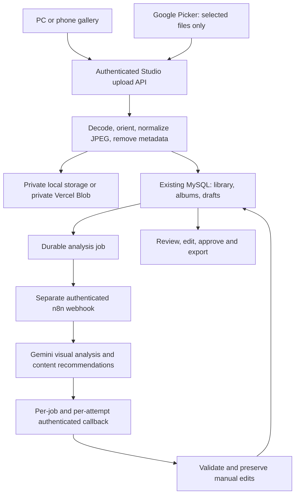

# Architecture

The Studio is a module inside the existing authenticated dashboard, not another
application or login. Existing portfolio APIs, forms, agents and the read-only
n8n monitoring collector are unchanged.

Uploads are one raw request per photo, maximum 4 MB by default, up to 30 in a
browser batch. No originals or EXIF are retained server-side. The server decodes
with a 40 MP bound, rejects unsupported/animated images, orients and limits the
longest dimension to 2400 pixels, and computes original-byte SHA-256 plus dHash.
No duplicate source file is deleted. Similarity is a fallible hint, not identity.

Library metadata, albums, draft selections/locks, suggestions and jobs persist
in MySQL. Private media reads require the existing owner session. Analysis
dispatch sends only 768px normalized previews, UUIDs, user-supplied theme and
confirmed location. It does not send the original file name, GPS or filesystem
path. The n8n workflow does not save execution data and never posts to Instagram.

Job creation is durable before dispatch. A bounded six-second webhook request
waits only for acceptance, not AI completion. Offline jobs become
`waiting_for_n8n`. A new attempt has a new scoped callback signature, up to
three attempts. Expired processing jobs display failed; explicit retry or the
recovery endpoint can resume work. The deadline is 15 minutes. Cancellation
rejects later callbacks; it cannot undo an already-started AI provider request.

Callbacks lock the draft and job in a consistent transaction order, validate
every photo ID and metric, and are idempotent. A changed draft revision retains
the result on the job without overwriting user changes. Locked positions,
forced inclusions, exclusions and a manual caption survive recommendations.

Future publishing is deliberately disabled. Approval saves `approved`; edits
return it to `draft`. The history table is reserved for a later verified Meta
integration. Existing status monitoring uses its original separate key.
